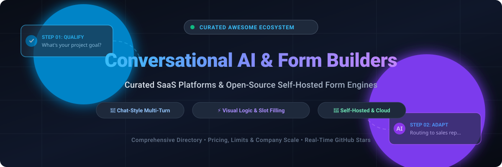

# 💬 Awesome Conversational AI & Form Builder 🤖

  <strong>Curated Directory of Top SaaS Platforms &amp; Open-Source Self-Hosted Conversational Form Builders</strong> 
  <em>Next-Generation Chat Forms, Lead Qualification Bots, Multi-Turn Surveys &amp; Visual Logic Automation</em>

  
  
  
  
  
  

---

## 📌 Overview & SEO Insights

Welcome to the **Awesome Conversational AI & Form Builder** repository—the most complete, regularly maintained guide to **conversational forms**, **chat-based survey tools**, **conversational marketing agents**, and **open-source form builders**. 

Traditional web forms create friction with static walls of inputs and high bounce rates. Modern conversational form builders replace checkboxes and long pages with dynamic, chat-style multi-turn dialogues—asking questions one at a time, branching conditionally based on responses, and qualifying leads conversationally.

Whether you're looking for enterprise SaaS solutions (**Typeform, Drift, Intercom, ManyChat**) or self-hostable, privacy-first open-source engines (**Typebot, HeyForm, Formbricks, Chatwoot, Rasa**), this list covers verified starting prices, free-tier limits, company scale, and GitHub Stars_Counts.

### 🔍 Key Capabilities Tracked
- 🧩 **Visual Flow Builders**: Drag-and-drop conversational decision trees and conditional branching logic.
- 🤖 **AI-Native Dynamic Questioning**: Natural language form generation (DSPy, LLMs) and adaptive context-aware follow-ups.
- 📱 **Omnichannel Chat Deployment**: Webchat widgets, WhatsApp Business API, Facebook Messenger, Instagram DMs, Telegram, and Slack.
- 🛡️ **Self-Hosting & Data Sovereignty**: GDPR/CCPA-compliant self-hosted deployments using Docker, PostgreSQL, and SQLite.
- 🔌 **Agentic Workflows & Tool Calling**: Model Context Protocol (MCP) clients, webhooks, and direct CRM integrations.

---

## 📑 Table of Contents

- [📊 Sector Overview & Market Dynamics](#-sector-overview--market-dynamics)
- [☁️ SaaS/Hosted Platforms](#️-saashosted-platforms)
- [💻 Open-Source GitHub Projects](#-open-source-github-projects)
- [🤝 How to Contribute](#-how-to-contribute)
- [💖 Support & Sponsorship](#-support--sponsorship)
- [⭐ Star History](#-star-history)
- [📜 Disclaimer](#-disclaimer)

## 📊 Sector Overview & Market Dynamics

The global conversational AI and smart form builder sector represents an estimated **$14B–$18B** market across conversational automation, intelligent chatbots, and enterprise data collection software, growing at over 20% CAGR. The industry exhibits a bifurcated market structure: the foundational enterprise AI infrastructure layer is **concentrated** among tech hyperscalers, while the application layer of conversational form builders and conversational marketing tools is **highly fragmented** with intense competition across self-serve SMB tools, point solutions, and generative AI workflow builders.

## ☁️ SaaS/Hosted Platforms

| Platform | Company Scale (Valuation / Revenue) | Starting Price | Free Tier / Trial Limit | Key Focus |
| :--- | :--- | :--- | :--- | :--- |
| **[Intercom Bots](https://www.intercom.com/)** | **$3.6B valuation** (Acquired by Salesforce for $3.6B; ~$400M ARR) | **$29/seat/month** (Essential plan, billed annually) | **14-day free trial** with full access to inbox, Fin AI agent, and workflow add-ons (no permanent free tier) | AI customer service & lead qualification platform with outcome-based AI agent (Fin) |
| **[Drift](https://www.drift.com/)** | **$1B+ valuation** (Acquired by Vista Equity Partners / merged with Salesloft) | **$2,500/month** (Premium tier, billed annually) | **Sales-assisted demo only** (no self-serve free plan or public trial; custom PoC available via sales) | Enterprise conversational marketing, pipeline acceleration & meeting scheduling |
| **[Typeform](https://www.typeform.com/)** | **$935M valuation** (Prior Series C valuation; acquired by Bending Spoons; ~$70M+ ARR) | **$28/month** (Basic plan, billed annually; or $39/mo billed monthly) | **Free-forever plan**: 10 responses/month across unlimited forms, 1 user seat | The category-defining conversational "one question at a time" form builder |
| **[Voiceflow](https://www.voiceflow.com/)** | **$105M valuation** (~$38M total funding raised; ~$15M–$30M ARR) | **$60/month** (Pro plan with 3 editor seats included) | **Free-forever plan**: Testing sandbox with one-time credit grant, up to 2 agents (non-production) | Collaborative conversational AI design, prototyping, and multi-agent deployment |
| **[ManyChat](https://manychat.com/)** | **$163M+ funding / ~$50M+ ARR** ($140M Series B by Summit Partners in 2025) | **$14/month** (Essential tier, billed annually; or $17/mo billed monthly) | **Free-forever plan**: Capped at 25 monthly active contacts, 2 channels, and up to 4 live automations | Social messaging automation for Instagram, WhatsApp, Messenger & TikTok |
| **[SurveySparrow](https://surveysparrow.com/)** | **~$46M ARR** ($1.4M seed funding raised; highly capital-efficient) | **$19/month** (Basic plan, billed annually) | **Free-forever plan**: 75 responses/quarter, 1 user, up to 3 active surveys (plus 14-day full-featured trial) | Conversational surveys, employee pulse, and omnichannel customer feedback |
| **[Landbot](https://landbot.io/)** | **~$7M–$10M ARR** ($10.2M total funding raised) | **€40/month** (Starter plan; ~€36/month billed annually) | **Free-forever Sandbox plan**: 100 chats/month, 1 user seat, web channel only | Visual drag-and-drop chat-first form builder with WhatsApp & web chatbots |
| **[Tars](https://tars.com/)** | **~$7M–$15M ARR** (Bootstrapped / seed accelerator backing) | **$499/month** (Business tier with live chat & CRM integrations) | **Free-forever plan**: 50 conversations/month, 5 knowledge bases, basic LLMs | Conversational landing pages and AI agents tailored for lead conversion |
| **[Chatfuel](https://chatfuel.com/)** | **~$4M–$8M ARR** ($1.5M funding raised) | **$18/month** (Fuely plan, billed annually; or $39/mo billed monthly) | **7-day free trial** with access to core templates and trial AI message credits (no permanent free tier) | Omnichannel e-commerce & social messaging bot builder for WhatsApp & IG |
| **[Botsify](https://botsify.com/)** | **~$200K–$1M ARR** (Bootstrapped micro-SaaS) | **$49/month** (Basic plan for website & Facebook bots) | **Free trial**: 100 test message credits and basic builder access (no permanent free tier) | Multi-platform chatbot builder with live chat fallback and form collection |

## 💻 Open-Source GitHub Projects

- **[Chatwoot](https://github.com/chatwoot/chatwoot)**   
  **Open-source customer engagement suite and alternative to Intercom and Drift** (MIT) — **omnichannel conversational platform** featuring website live chat widgets, lead qualification bots, shared inbox, interactive conversation forms, and CRM integrations across WhatsApp, Twitter, and Facebook.

- **[Rasa](https://github.com/RasaHQ/rasa)**   
  **Open source machine learning framework for conversational software** (Apache-2.0) — **Rasa Forms (FormValidationAction)** provides industrial-grade slot filling and conversational form logic, allowing bots to collect information via dynamic multi-turn dialogue with fallbacks, validations, and contextual disambiguation.

- **[Botpress](https://github.com/botpress/botpress)**   
  **The open-source conversational AI platform** (AGPL-3.0 / Botpress Open License) — **visual flow builder with rich conversational forms and slot extraction**, NLU engine, multi-channel deployment (webchat, WhatsApp, Slack, Teams), and seamless API/webhook integrations.

- **[Formbricks](https://github.com/formbricks/formbricks)**   
  **Open-source survey and conversational form suite** (AGPL-3.0) — **modular, privacy-first Typeform alternative** with in-app conversational micro-surveys, web forms, conditional branching logic, user targeting, and multi-channel delivery built with Next.js and TypeScript.

- **[Typebot](https://github.com/baptisteArno/typebot.io)**   
  **Visual builder for creating conversational apps and lead flows** (AGPL-3.0) — **the reference implementation for open-source conversational forms** with visual drag-and-drop flow builder, conditional logic, multi-channel deployment (web, WhatsApp, Facebook Messenger, Slack), analytics, and self-hostable Docker architecture.

- **[HeyForm](https://github.com/heyform/heyform)**   
  **Open-source conversational form builder** (AGPL-3.0) — **modern, interactive form creation platform** with smooth conversational UX, customizable layouts, logic jumps, 20+ question blocks, team collaboration, and self-hostable deployment with Docker Compose.

- **[OpnForm](https://github.com/OpnForm/OpnForm)**   
  **Simple and open-source form builder** (AGPL-3.0) — **no-code builder with infinite fields and submissions**, 20+ input types, embed anywhere, email notifications, hidden fields, form passwords, URL pre-fill, Slack integration, webhooks, form logic, custom colors, and submission limits (built with Laravel + Vue.js + TailwindCSS).

- **[Conversational Form](https://github.com/space10-community/conversational-form)**   
  **Turning web forms into conversations** (MIT) — **open-source concept and framework by SPACE10** that automatically transforms traditional HTML `<form>` elements into dynamic, chat-based conversational UIs with zero server-side setup required.

- **[OhMyForm](https://github.com/ohmyform/ohmyform)**   
  **Free open-source alternative to TypeForm, TellForm, or Google Forms** (MIT) — **API-first form builder** with multi-language support, 11 question types, editable start and end pages, export submissions to XLS/JSON/CSV, native analytics, embeddable forms, webhooks, and PostgreSQL/SQLite support.

- **[ChatbotX](https://github.com/ChatbotXIO/ChatbotX)**   
  **Open-source omnichannel chatbot platform** (Apache-2.0) — **a modern alternative to ManyChat for agencies and self-hosters** with visual flow builder (15+ node types), AI agent support (OpenAI, DeepSeek, Gemini), live chat inbox with human takeover, contact CRM, broadcasts, sequences, comment-to-DM, MCP support, and integrations across WhatsApp, Instagram, Telegram, and Webchat.

- **[Forms.md](https://github.com/formsmd/formsmd)**   
  **Developer-first, open-source Typeform alternative** (MIT) — **create multi-step conversational forms using Markdown-like syntax and visual editor**, offering programmable workflows, custom logic jumps, and self-hosted control.

- **[QuillForms](https://github.com/quillforms/quillforms)**   
  **Open Source TypeForm Alternative Based on React JS and TypeScript** (GPL-3.0) — **conversational multi-step form renderer** delivering a pixel-perfect Typeform clone experience with rich themes, animations, jump logic, and custom block extendability.

- **[Formizee](https://github.com/formizee/formizee)**   
  **Open-source form backend and submission infrastructure** (Apache-2.0) — **self-hostable alternative to Formspree** built with Next.js, TypeScript, Tailwind CSS, and LibSQL/Turso, enabling seamless conversational or static form data collection, spam filtering, and webhook dispatches.

- **[TalkForm.AI](https://github.com/nsbradford/TalkFormAI)**   
  **Create and fill forms with chat** (MIT) — **AI-native form creation where users describe forms in natural language**, LLMs infer field types, and users can fill the forms conversationally while preserving structured tabular data.

- **[DialogFlow-Form](https://github.com/Haseeb-Arshad/dialogflow-form)**   
  **Dynamic conversational forms and surveys powered by LLMs** (MIT) — **prompt-based creation and adaptive AI questioning** that maintains a conversational tone, handles follow-ups, and logs structured responses via Vue.js and OpenAI models.

- **[AutoForm](https://github.com/FireBird-Technologies/AutoForm)**   
  **AI Intelligent form builder** (Apache-2.0) — **generates smart forms with skip logic, 20+ question types, conditional validation, and analytics** from natural language prompts using React, TypeScript, FastAPI, and DSPy.

- **[OraOne](https://github.com/OraOneHQ/oraone-web)**   
  **Open-source AI Chat & WhatsApp agent platform** (AGPL-3.0) — **RAG knowledge base, embeddable chat widget, lead qualification forms**, self-hosted authentication, analytics, and public REST API for automated conversational workflows.

💡 **Frameworks for building custom systems**: Combine **Typebot** or **HeyForm** for visual conversational flows with **Formbricks** or **OpnForm** for structured form building, **Chatwoot** or **ChatbotX** for omnichannel messaging and live takeover, **Rasa** for enterprise conversational AI slot-filling, and **TalkForm.AI** or **AutoForm** for generative prompt-to-form creation.

## 🤝 How to Contribute

Contributions are warmly welcome! Help make this the most up-to-date and comprehensive directory:

1. 🍴 **Fork the repo**.
2. ✍️ **Add or edit entries** in `README.md` following the standard table/badge format.
3. 📝 **Include details**: Tool name, link, concise factual description, pricing, and license.
4. 🚀 **Submit a Pull Request** with a brief summary of additions or updates.

🌟 **Star this repository** if you found it useful for your conversational AI stack!

## 💖 Support & Sponsorship

Thank you for visiting and using this repository! If this curated guide helped you discover tools, save hours of research, or build better conversational workflows, please consider supporting the project:

- ⭐ **Star this repo** to help others discover it on GitHub.
- 🍴 **Fork and share** it with your developer, marketing, and product communities.
- ☕ **Buy me a coffee / Sponsor**: If you'd like to support ongoing research and updates, check out the [Sponsor Dashboard](https://github.com/sponsors/ishandutta2007).

Your support keeps this directory independent, accurate, and continuously updated! 🙌

## ⭐ Star History

## 📜 Disclaimer

- 📌 This is a **community-curated** list — not exhaustive and not an official product endorsement.
- 🔒 **Data Protection & Compliance**: Conversational form builders handling personal user information must comply with data privacy laws (GDPR, CCPA, HIPAA, etc.) and include necessary consent banners.
- ⚡ **Production-Ready Open-Source**: Open-source solutions like Typebot, HeyForm, Formbricks, and Chatwoot are enterprise-grade alternatives to proprietary SaaS giants.
- 📈 **Conversational Completion Rates**: Multi-turn, chat-style forms overcome form fatigue by asking one question at a time with smart skip logic.
- 🤖 **Agentic & AI-Native Frontier**: The ecosystem is rapidly transitioning toward prompt-generated forms and autonomous agentic workflows orchestrated via protocols like MCP.
- 🛠️ **Self-Hosting Best Practices**: Form submissions contain valuable lead and customer data—ensure robust database encryption at rest, secure backups, and firewall protection.

---

**Crafted with ❤️ for marketers, product teams, and developers building the future of conversational forms.**  
*Let's make Conversational AI & Form Builders more open, data-driven, and engaging.*

